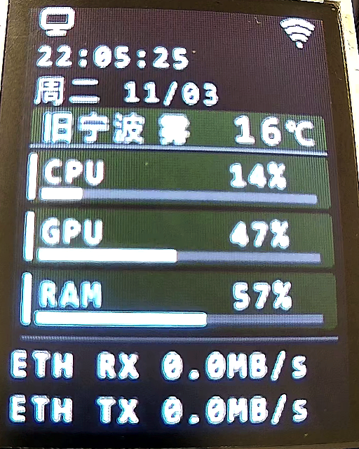
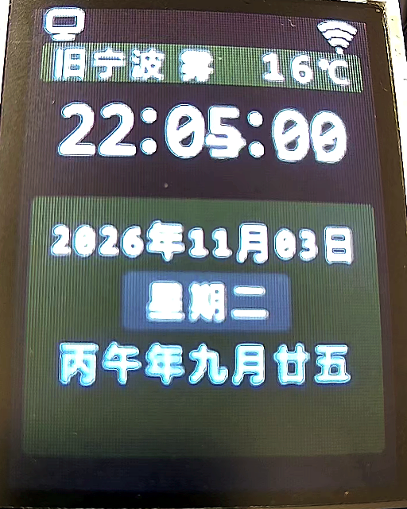

# Pico W 电脑状态屏

基于 Raspberry Pi Pico W（RP2040）与 ST7735S 128×160 SPI TFT 的桌面状态屏。Windows 主机通过有线网卡采集 CPU、GPU、系统内存占用与有线网卡收发速率，以 UDP 广播发送到局域网；Pico W 连接同一路由器的 Wi‑Fi，实时显示这些指标。电脑指标中断约 3 秒后，Pico 自动切换为时钟模式，显示时间、日期、星期、中文干支农历和在线天气。

仓库地址：<https://github.com/changBin-x/PcPartnerWithRpiPicoW>

## 界面预览

仪表盘模式（电脑指标在线）：



时钟模式（电脑指标离线）：



> 预览图于 2026-11-03 用 RTSP 相机拍摄设备屏幕后做透视校正（对应当日 M3 界面版本），亮度与颜色受拍摄环境影响，以实机显示为准；拍摄时天气行为缓存状态（带「旧」前缀，见「使用说明 · 天气行说明」）。

## 项目简介

这是一个「主机采集 + 单片机显示」的局域网小项目：

- 主机端（`pc_metrics/`）用 Python 与 psutil 采集指标，稳态约每秒向所在子网的定向广播地址发送一个不超过 512 字节的 JSON 数据包（UDP 8765）。
- Pico 端（`pico/`）用 MicroPython 接收指标并驱动 TFT 屏幕；没有指标时显示时钟、农历和天气。
- 主机端不开放任何 TCP/HTTP 端口，也不依赖云服务；数据只在本机所在广播域内传播。
- 当前版本已在 Pico W + ST7735S 上完成整机部署验证（MicroPython 1.29.0，2026-11-03）；`tests/` 下 190 项单元测试通过（Windows + Python 3.11.9，Linux + Python 3.12.3，2026-11-05）。

## 功能特性

### 电脑指标仪表盘

- CPU 使用率、系统内存占用率（psutil）。
- NVIDIA GPU 使用率（`nvidia-smi -i 0`，仅第一块 GPU）；没有 NVIDIA 驱动或查询超时（0.7 秒为软上限，超时后还需回收进程）时显示 `--`，不影响其他指标；连续 3 次失败后 10 秒内跳过查询，并在终端提示一次。
- 有线网卡实时收发速率，十进制 MB/s，保留 1 位小数。
- 稳态约每秒采样并广播一次（端口 8765）；启动后第一秒用于建立 CPU 与网卡计数基线，不发送数据包。
- 每个指标一张 Material Design 3 深色切角卡片，配 3 px 细进度条；RAM 超过 90% 时使用警示色。
- 顶栏显示电脑与 Wi‑Fi 状态图标，以颜色区分激活/非激活状态。

### 时钟与农历

- NTP 校时（`ntp.aliyun.com` 等阿里云 NTP 主机），按 UTC+8 显示；成功后每 6 小时重新校时，失败按 30 秒、1 分钟、5 分钟、15 分钟退避重试。
- 大号时间（26 px 数字）、公历日期、星期。
- 中文干支农历：优先使用随固件安装的香港天文台（HKO）1901–2100 年本地逐日表，表内日期无需联网；联网后由后台线程复核「当年及后两年」的 HKO 在线结果（连接超时 2 秒、整段响应有总超时），与本地表不一致时仅记录差异，显示仍以本地表为准，复核失败不影响本地结果显示，按 1、5、30、60 分钟退避重试。
- 时间未同步时显示 `--:--:--` 与「时间同步中」占位，仪表盘则显示 `TIME SYNC`；时钟页不再单独显示 NTP 状态行，同步结果直接体现在时间是否可用。

### 在线天气

- 高德 Web 服务 IP 定位 + 实况天气；可用六位 adcode 固定城市。
- 天气行显示城市、天气现象与摄氏温度；`旧` 前缀表示当前展示的是断网或请求失败前的缓存数据。
- 天气请求在后台线程执行，不阻塞绘屏与指标刷新；成功后每 30 分钟刷新，失败按 1、5、15、30 分钟退避。
- TLS 校验证书链与主机名，使用随固件部署的高德根证书；不提供关闭校验的开关。

### 状态与容错

- 电脑指标停止约 3 秒后自动切换到时钟模式；重新收到指标后立即回到仪表盘。
- 指标包严格校验（字段集合、数值范围、协议版本、重复/过期序号、JSON 合法性），非法包直接丢弃。
- 屏幕在时间秒数变化时立即重绘（兜底 1 秒），并且只刷新发生变化的区域，避免整屏闪烁。
- 主循环异常时显示 `APP ERROR` 错误页并在 2 秒后软重启；错误页复用已初始化的屏幕，不会重复初始化面板。异常文本不会写入串口（最多输出异常类型名），避免泄露可能包含的密钥。
- 主循环每拍喂一次 10 秒硬件看门狗；绘屏或网络路径卡死超过 10 秒时设备自动复位，串口会打印重启原因 `Pico reset cause: <code>`。
- Wi‑Fi 断开后自动重连（重试间隔 1、3、10、30 秒）；重连成功后重建 UDP 监听套接字，避免旧 lwIP 套接字失效导致指标中断。
- 天气请求与农历复核都在后台线程执行，并各自检查对方是否正忙来尽量避免同时握手，减小 RP2040 堆压力。

## 硬件连接

| 屏幕信号 | Pico W 引脚 |
| --- | --- |
| SCL / SPI SCK | GP18 |
| SDA / SPI MOSI | GP19 |
| RST | GP20 |
| DC | GP21 |
| CS | GP17 |

- 目标硬件为 **Pico W（RP2040）**，不是 Pico 2 W（RP2350）；项目使用 MicroPython 1.29.0，并已完成整机部署验证。
- SPI0，时钟 20 MHz，极性 0、相位 0，MSB first；屏幕供电与背光按模块标识接线（待补充：所用屏幕模块型号与供电电压）。
- 屏幕分辨率 128×160，RGB565，竖屏显示。

## 环境要求

| 项目 | 要求 | 说明 |
| --- | --- | --- |
| 主机系统 | Windows 10/11 + PowerShell | 采集启动与固件部署脚本为 PowerShell |
| Python | 3.10 或更新版本 | `tools/start_metrics.ps1` 启动前检查 |
| 主机依赖 | `psutil>=5.9,<8` | `requirements-host.txt` |
| 微控制器 | Raspberry Pi Pico W（RP2040） | 目标固件 MicroPython 1.29.0 |
| 显示屏 | ST7735S 128×160 SPI TFT | 接线见上表 |
| 部署工具 | `mpremote` | 可装在项目 `.venv` 或全局 PATH |
| GPU 采集（可选） | NVIDIA 驱动 + `nvidia-smi` | 缺失时 GPU 显示 `--` |
| 网络 | 主机有线、Pico Wi‑Fi 位于同一可广播子网 | 访客 Wi‑Fi、客户端隔离、跨 VLAN 会阻断广播 |
| 构建工具（可选） | `requests>=2.31,<3`、`Pillow>=10,<13` | 仅在重新生成字库或农历表时使用 |

Pico W 的无线模块仅支持 2.4 GHz 频段；路由器需开启 2.4 GHz，并关闭客户端隔离（AP Isolation）。

## 安装与运行

### 1. 安装并启动 Windows 指标服务

```powershell
python -m pip install -r requirements-host.txt
```

编辑 `pc_metrics/config.py`：

| 配置项 | 默认值 | 说明 |
| --- | --- | --- |
| `ETHERNET_INTERFACE` | `"以太网"` | 有线网卡名称；程序按该网卡默认网关匹配 IPv4 子网 |
| `ETHERNET_IPV4_ADDRESS` | `""` | 可选；网卡有多个地址或读不到默认网关时，强制指定 IPv4 地址 |
| `UDP_PORT` | `8765` | UDP 广播端口 |
| `SAMPLE_INTERVAL_SECONDS` | `1.0` | 采样与广播间隔（秒） |

启动：

```powershell
powershell -ExecutionPolicy Bypass -File tools/start_metrics.ps1
```

脚本会检查 `python.exe`（会识别 Microsoft Store 的占位程序）、Python ≥ 3.10 与 `psutil` 版本区间 `>=5.9,<8`，然后运行 `python -m pc_metrics.host`。退出码：`0` 正常/Ctrl+C，`1` 环境不满足，`2` 主机采集器启动失败（网卡、地址、端口或采样间隔配置问题，原因打印在 stderr）。启动成功会打印实际使用的网卡地址、广播目标与采样间隔，例如：

```text
有线网卡：以太网 (192.168.1.10)；UDP 广播：192.168.1.255:8765；采样间隔：1 秒。按 Ctrl+C 停止。
```

> 上面的 IP 只是示例。程序按网卡默认网关推导子网广播地址，不写死网段；广播地址必须属于该网卡的 IPv4 子网。

### 2. 配置 Pico 本地参数

在项目根目录复制模板并填写（两个文件均已被 `.gitignore` 忽略）：

```powershell
Copy-Item pico/wifi_secrets.example.py pico/wifi_secrets.py
Copy-Item pico/weather_secrets.example.py pico/weather_secrets.py
notepad pico/wifi_secrets.py
notepad pico/weather_secrets.py
```

| 文件 | 字段 | 说明 |
| --- | --- | --- |
| `pico/wifi_secrets.py` | `SSID` | 路由器 Wi‑Fi 名称 |
| | `PASSWORD` | Wi‑Fi 密码 |
| `pico/weather_secrets.py` | `AMAP_WEB_KEY` | 高德开放平台 **Web 服务** Key（需启用 IP 定位与天气查询） |
| | `CITY_OVERRIDE_ADCODE` | 可选；六位高德 adcode，留空则按公网 IPv4 自动定位 |

**安全提示**：`*_secrets.py` 不得提交、粘贴到聊天或日志，也不要出现在截图中。天气 Key 会随固件写入 Pico 闪存，设备持有者可能提取；建议为设备单独创建 Key 并限制配额。部署脚本只检查文件是否存在，不读取、不显示配置内容。

### 3. 安装 mpremote 并部署固件

若 `mpremote` 未安装：

```powershell
python -m pip install mpremote
```

部署脚本会优先使用项目 `.venv\Scripts\mpremote.exe`，找不到时使用 PATH 中的 `mpremote`。

确认 Pico 串口未被 Thonny 等程序占用，然后运行（默认 `COM4`）：

```powershell
powershell -ExecutionPolicy Bypass -File tools/deploy_pico.ps1
```

指定其他串口：

```powershell
powershell -ExecutionPolicy Bypass -File tools/deploy_pico.ps1 -Port COM5
```

部署脚本会：

1. 检查 `pico/wifi_secrets.py` 与 `pico/weather_secrets.py` 是否存在（缺失时退出码 `2`）；
2. 检查部署清单中的固件文件是否齐全；
3. 枚举系统串口，确认 `-Port` 指定的端口真实存在，再通过 `mpremote` 只读探测设备，确认运行的是 MicroPython；
4. 在设备上创建 `/pico/` 并校验 `PICO_PACKAGE_READY` 哨兵，上传 17 个文件（15 个固件文件 + 2 份本地配置，含两份 TLS 根证书、字库 `font_cn.bin` 与农历表 `lunar_table.bin`），并把 `pico/main.py` 复制为设备根目录 `/main.py`；
5. 重启设备。

退出码：`0` 成功，`1` 一般失败（文件缺失、端口不存在、mpremote 缺失、连接/上传失败或超时），`2` 缺少本地配置。连接探测与建目录各 30 秒超时，上传 180 秒超时；超时通常是 Thonny 占用串口或设备无响应，按提示拔插（必要时按住 BOOTSEL）后重试即可，重复运行会覆盖同名文件、不会删除设备上的其他文件，也不会显示配置内容。

### 4. 上电自检

设备重启后自动运行 `/main.py`：连接 Wi‑Fi → NTP 校时 → 显示时钟模式并请求天气；收到电脑指标后切换到仪表盘。正常使用时不需要打开 Thonny 或其他串口工具。

## 使用说明

### 显示模式

| 模式 | 触发条件 | 屏幕内容 |
| --- | --- | --- |
| 仪表盘 | 最近 3 秒内收到有效指标包 | 顶栏图标、时间、日期、天气行、CPU/GPU/RAM 卡片与进度条、ETH RX/TX 速率 |
| 时钟 | 未收到指标或超过 3 秒未更新 | 顶栏图标、天气行、大号时间、日期/星期、中文干支农历 |

### 顶栏状态图标

- 左侧为电脑图标，右侧为 Wi‑Fi 图标。
- 电脑图标：仪表盘模式为激活色，时钟模式（电脑离线）为非激活色。
- Wi‑Fi 已连接时点亮，断开时切换为非激活色。
- 激活色与警示色定义在 `pico/display.py` 的 M3 颜色常量中。

### 天气行说明

| 显示 | 含义 |
| --- | --- |
| `宁波 雾 16℃` | 天气数据正常 |
| `旧 宁波 雾 16℃` | 断网或请求失败，展示上一次成功获取的缓存数据 |
| `天气获取中` | 正在请求或等待时间同步 |
| `天气未配置` | 未填写 `AMAP_WEB_KEY` |
| `WIFI CONFIG` | 未填写 Wi‑Fi SSID，等待本地配置 |
| `天气暂不可用` | 请求失败且没有可用缓存 |

### 串口日志

使用 `mpremote` 或其他串口工具查看设备输出（Pico 通过 USB CDC 通信，波特率参数不影响数据）。注意：调试会中断正在运行的 `main.py`，结束后请重启设备。

- `WX ok <温度> <天气>`：天气刷新成功。
- `WX err <异常类型> [<errno>]`：天气刷新失败，只输出类型名与数字错误码（如存在），不输出 URL、Key 或响应体。
- `NTP err <异常类型>`：本轮三个 NTP 主机全部失败，随后按退避重试。
- `HKO err <异常类型>`：农历在线复核失败，本地表结果继续显示。
- `Pico reset cause: <code>`：启动时打印本次复位来源，用于区分上电、看门狗复位与软复位。
- 应用异常：屏幕显示 `APP ERROR`；若错误页也无法绘制，串口输出 `Pico dashboard error: <异常类型>`。

### 现场验收步骤

1. 启动主机指标服务，确认打印的网卡地址与广播目标属于预期网段。
2. 上电 Pico，确认串口出现 `WX ok`，屏幕显示时间、日期、农历与天气。
3. 观察仪表盘：CPU/GPU/RAM 数值与 Windows 任务管理器大致一致；`ETH RX/TX` 随网络活动变化。
4. 停止指标服务（或拔掉主机网线），约 3 秒后屏幕切换到时钟模式。
5. 重新启动指标服务，屏幕应立即回到仪表盘。
6. 断开 Pico 的 Wi‑Fi（或关闭路由器外网并等待下一次天气刷新），确认天气行出现 `旧` 标记；NTP 已校时的情况下时间仍正常走时。
7. 重启 Pico，确认无需打开 Thonny 即可自动恢复显示。
8. 运行中拔掉再插回主机网线：主机服务不应退出，终端可见「采样或广播失败：…；N 秒后重试」，网卡恢复后仪表盘自动回填。
9. 若屏幕卡死超过 10 秒，看门狗应复位设备；串口重启后打印 `Pico reset cause: <code>`。

### 常见问题

| 现象 | 排查方向 |
| --- | --- |
| 启动报「启动失败：ETHERNET_INTERFACE 必须是非空字符串」或「有线网卡“…”不存在或未连接」 | 核对 `pc_metrics/config.py` 的 `ETHERNET_INTERFACE`；网卡未启用或名称不符，报错信息会列出候选网卡 |
| 启动报「启动失败：UDP_PORT …」「SAMPLE_INTERVAL_SECONDS …」 | 配置值类型或范围不合法（端口 1–65535 的整数、间隔为有限正数） |
| 运行中出现「采样或广播失败：…；N 秒后重试」 | 网卡被拔/禁用、计数器重置或编码失败；服务按 1/2/5/10/20/30 秒退避并自动重建广播端点，恢复后继续 |
| 启动报「无法读取有线网卡…的 IPv4 默认网关」 | 网卡没有默认网关，或系统限制读取网络配置；用 `ETHERNET_IPV4_ADDRESS` 显式指定地址 |
| Pico 一直显示时钟模式 | 主机与 Pico 不在同一广播域、Pico Wi‑Fi 未连接，或 UDP 8765 被防火墙拦截 |
| 天气行显示「天气未配置」 | 未填写 `AMAP_WEB_KEY`，或 Key 未启用 Web 服务 |
| 天气行显示「旧」 | 设备无法访问高德 API（DNS/TLS/网络出口问题），先检查串口 `WX err` |
| 时间显示 `--:--:--` | Pico 未联网或 NTP 请求失败；确认 Wi‑Fi 与 UDP 123 出站未被拦截 |
| 部署失败（退出码 1） | 串口被占用、`-Port` 指定的端口不存在、未安装 `mpremote`，或设备未运行 MicroPython；脚本会列出本机串口 |
| 部署报缺少本地配置（退出码 2） | 未复制 `pico/wifi_secrets.py` 或 `pico/weather_secrets.py` |
| GPU 显示 `--` | 没有 NVIDIA 显卡/驱动、`nvidia-smi` 不在 PATH，或连续失败后处于 10 秒降频期（终端会提示一次） |

## 配置参考

### 主机配置

见上文「安装与运行」中的 `pc_metrics/config.py` 表格；修改后需重新启动指标服务生效。

### 代码内常量

| 常量 | 值 | 位置 |
| --- | --- | --- |
| UDP 广播端口 | `8765` | `pc_metrics/config.py`、`pico/udp_receiver.py` |
| 指标包上限 | `512` 字节 | `pc_metrics/protocol.py`、`pico/udp_receiver.py` |
| 协议版本 | `1` | `pc_metrics/protocol.py` |
| 离线判定 | `3000` 毫秒 | `pico/app.py` |
| 主循环 tick | `100` 毫秒 | `pico/app.py` |
| 重绘时机 | 时间秒数变化（兜底 `1000` 毫秒） | `pico/app.py` |
| 看门狗超时 | `10000` 毫秒 | `pico/main.py` |
| 天气/农历响应总超时 | `5` 秒 | `pico/weather.py` |
| 农历在线复核退避 | 1 / 5 / 30 / 60 分钟 | `pico/lunar.py` |
| 天气刷新 | 30 分钟 | `pico/weather.py` |
| 天气失败退避 | 1 / 5 / 15 / 30 分钟 | `pico/weather.py` |
| NTP 重校间隔 | 6 小时 | `pico/time_sync.py` |
| NTP 失败退避 | 30 秒 / 1 / 5 / 15 分钟 | `pico/time_sync.py` |
| Wi‑Fi 重连间隔 | 1 / 3 / 10 / 30 秒 | `pico/wifi.py` |
| 农历本地表范围 | 1901–2100 | `pico/lunar_table.bin`（生成器 `tools/build_lunar_table.py`） |

> 以上常量以对应源文件为准；修改 Pico 端常量后需要重新部署固件。

## 目录结构

```text
pc_partner/
├─ pc_metrics/              # Windows 主机采集与 UDP 广播
│  ├─ __init__.py           # 包标记
│  ├─ config.py             # 网卡、端口、采样间隔配置
│  ├─ collectors.py         # CPU/GPU/内存/网卡速率采集
│  ├─ broadcaster.py        # 子网广播地址计算与 UDP 发送
│  ├─ protocol.py           # v1 JSON 指标包编解码与校验
│  └─ host.py               # 主程序入口（python -m pc_metrics.host）
├─ pico/                    # Pico W MicroPython 固件
│  ├─ __init__.py           # 包标记
│  ├─ main.py               # 设备启动入口（部署为 /main.py）
│  ├─ app.py                # 主循环、模式切换与调度
│  ├─ display.py            # M3 仪表盘/时钟布局与局部刷新
│  ├─ st7735.py             # ST7735S SPI 驱动与字形绘制
│  ├─ font_cn.py            # 中文字库索引（生成文件，勿手改）
│  ├─ font_cn.bin           # 中文字库位图（放在 flash）
│  ├─ glyph_font.py         # 从 flash 按需读取字形
│  ├─ udp_receiver.py       # UDP 8765 接收与指标校验
│  ├─ wifi.py               # Wi‑Fi 连接与重连状态机
│  ├─ time_sync.py          # NTP 校时与时间格式化
│  ├─ lunar.py              # 农历本地表查询与 HKO 在线复核
│  ├─ lunar_table.bin       # HKO 农历本地表（1901–2100）
│  ├─ weather.py            # 高德定位/天气后台线程
│  ├─ amap_root_ca.pem      # 高德根证书
│  ├─ hko_root_ca.pem       # HKO 根证书
│  ├─ wifi_secrets.example.py
│  └─ weather_secrets.example.py
├─ tools/
│  ├─ start_metrics.ps1     # 启动主机指标服务
│  ├─ deploy_pico.ps1       # 通过 mpremote 部署固件
│  ├─ build_font.py         # 生成中文字库
│  └─ build_lunar_table.py  # 生成农历本地表
├─ tests/                   # Python unittest（主机与 Pico 逻辑）
├─ images/                  # README 界面预览图
├─ docs/                    # 本地设计/交接资料（不纳入版本库）
├─ .gitignore               # 忽略本地配置与内部资料
├─ requirements-host.txt
├─ requirements-build.txt
└─ README.md
```

`pico/wifi_secrets.py`、`pico/weather_secrets.py` 为本地配置，不纳入版本库；`docs/` 下的规格、计划与交接文档同样被 `.gitignore` 忽略。

## UDP 协议

主机稳态约每秒发送一个 UTF-8 JSON 数据包（紧凑格式），字段固定为 8 个：

| 字段 | 类型 | 说明 |
| --- | --- | --- |
| `v` | int | 协议版本，固定为 `1` |
| `seq` | int | 序号，从 0 递增，仅在发送成功后加一 |
| `ts` | int | 采样时间，Unix 秒 |
| `cpu` | number | CPU 使用率 0–100 |
| `gpu` | number \| null | GPU 使用率 0–100，无数据时为 `null` |
| `ram` | number | 内存占用率 0–100 |
| `rx` | number | 有线网卡接收速率，MB/s |
| `tx` | number | 有线网卡发送速率，MB/s |

示例：

```json
{"v":1,"seq":42,"ts":1793713669,"cpu":16.0,"gpu":38.0,"ram":57.0,"rx":0.1,"tx":0.0}
```

约束：数据包不超过 512 字节；`cpu`/`gpu`/`ram` 限定 0–100，`seq`/`ts`/`rx`/`tx` 只校验下界（`seq >= 0`、`ts >= 1`、速率非负），允许任意大的正数。主机生产路径只做编码；`pc_metrics.protocol.decode_packet` 供测试与诊断使用，拒绝重复字段、`NaN`/`Infinity`、多余或缺失字段与上述越界数值，并单独报告重复字段名。Pico 端会丢弃重复序号、明显过期以及校验失败的包。

协议没有校验和/CRC，完整性依赖 UDP 报文本身与 JSON 字段严格校验；损坏或不合规的数据包会被直接丢弃，不会显示到屏幕。

> 协议为局域网明文广播，没有认证或加密；同一广播域内的主机都可以发送或伪造指标包，请只在可信内网使用。

## 开发与测试

在项目根目录使用 PowerShell：

```powershell
python -m pip install -r requirements-host.txt
python -m unittest discover -s tests -v
python -m compileall pc_metrics tests tools pico
```

- 测试覆盖协议编解码、采集与广播地址、主机循环容错与重建、显示布局、应用主循环（秒对齐/重连/看门狗）、时钟/农历、天气后台线程、Wi‑Fi 状态机、启动入口与部署清单等；涉及真实硬件与网络的路径以实机验证为准。
- 验证环境：Windows + Python 3.11.9 与 Linux + Python 3.12.3；`python -m unittest discover -s tests` 共 190 项全部通过（2026-11-05），`python -m compileall pc_metrics tests tools pico` 无错误。
- 主机侧与 Pico 逻辑用 mock/注入覆盖，不依赖真实网卡或串口；两个 PowerShell 脚本有静态一致性测试（`tests/test_deploy_manifest.py`）但未在 CI 中执行，改动后需在 Windows PowerShell 5.1 与 pwsh 7 各实跑一次。仓库当前未配置 CI。
- 重新生成字库（需 CJK TTF/OTF 与 ASCII 字体）：

  ```powershell
  python -m pip install -r requirements-build.txt
  python tools/build_font.py --font <CJK字体路径> --ascii-font <ASCII字体路径>
  ```

- 重新生成农历表（需要能访问 HKO 数据）：

  ```powershell
  python tools/build_lunar_table.py
  ```

`pico/font_cn.py` 与 `pico/font_cn.bin` 由 `tools/build_font.py` 生成，`pico/lunar_table.bin` 由 `tools/build_lunar_table.py` 生成，请勿手工修改。

## 已知限制

- 仅采集有线网卡速率；Wi‑Fi 网卡速率不参与显示。
- GPU 仅支持 NVIDIA（`nvidia-smi`）；AMD/Intel 显卡显示 `--`。
- 主机与 Pico 必须位于同一可广播子网；访客网络、客户端隔离与跨 VLAN 会阻断 UDP 广播。
- 天气定位依赖大陆 IPv4 出口；可用 `CITY_OVERRIDE_ADCODE` 固定城市。
- 农历本地表覆盖 1901–2100；HKO 在线 API 复核仅限其文档支持的「当年及后两年」，表外年份只使用本地表结果。
- HKO 在线农历复核 API 的端到端可用性尚未完成验收：开发环境发现其中间 CA 已被撤销，而设备没有 CRL/OCSP 支持，且不允许关闭 TLS 校验；该路径失败时保留本地表结果并在串口输出 `HKO err`。复核在后台线程执行，但 DNS 解析（`getaddrinfo`）本身没有代码级超时，极端情况下该后台线程可能长时间不返回（显示不受影响）。
- 首次上电或断电后需要联网完成 NTP 校时，时间才可用。
- 指标包为局域网明文广播，无认证/加密，不适用于不可信网络。
- 天气 Key 会写入设备闪存，存在被设备持有者提取的风险；请使用独立 Key 并限制配额。

## 许可证

(待补充：仓库当前未包含 LICENSE/COPYING 文件，许可证类型与版权声明需由项目维护者确认。)

## 参考链接

- 高德开放平台 Web 服务：<https://lbs.amap.com/api/webservice/summary>
- 高德天气查询：<https://lbs.amap.com/api/webservice/guide/api/weatherinfo>
- 香港天文台开放数据（农历）：<https://www.hko.gov.hk/sc/abouthko/opendata_intro.htm>
