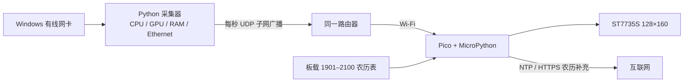

# Pico Wi-Fi 电脑状态屏设计说明

**状态：已由用户批准（2026-10-31）**
**目标硬件：** Raspberry Pi Pico W（RP2040，COM4 上 MicroPython 1.29.0）、ST7735S 128×160 TFT
**已确认屏幕选择：** 在线仪表盘 B；断连时钟 B

## 目标

把 128×160 屏幕做成可独立运行的小型电脑状态屏。Windows 电脑保持有线联网并手动启动采集器；Pico 连接同一台路由器的 Wi-Fi，接收指标并绘制深色仪表盘。电脑指标停止到达时，Pico 保留 Wi-Fi，切换到全屏时钟和日历。Pico 程序、Wi-Fi 配置写入板载文件系统，断电后重新上电自动运行。

## 已确认的产品选择

| 项目 | 选择 |
|---|---|
| 屏幕 | ST7735S，128×160 RGB TFT；已有五根 SPI 信号线按 GP18/GP19/GP20/GP21/GP17 接好 |
| 在线布局 | B：指标优先；时间、短格式公历日期/星期和干支农历日期压缩在顶部；CPU/GPU/RAM 数值和进度条居中；ETH 接收/发送速度位于底部 |
| 断连布局 | B：突出 HH:MM:SS；公历日期、中文星期和干支农历日期紧凑排列；显示 Wi-Fi 与时间同步状态 |
| 风格 | 深色底、青色强调、清晰百分比进度条；内存条使用区分色 |
| 主机指标 | CPU 总使用率、GPU 使用率、系统物理 RAM 使用率；不显示显存 |
| 网络指标 | 电脑当前有线网卡的接收和发送速度，分别显示，单位 MB/s，一位小数 |
| 刷新 | 主机每秒采集并广播；Pico 收到新包后更新画面 |
| 传输 | Windows → 局域网 UDP 广播 → Pico；电脑不运行接收入站连接的服务，不需要新增电脑入站端口 |
| 断线判据 | 连续约 3 秒未收到有效指标包，转全屏时钟；收到有效包后恢复仪表盘 |
| 时间 | Pico 联网后通过 NTP 校准，按中国标准时间 UTC+8 显示；电脑断连时继续留在路由器 Wi-Fi |
| 农历 | 全中文，带干支年，不加“农历”前缀；本地权威年表优先，在线 API 作为校验/越界补充；两者都不可用时显示“历日暂不可用” |
| 启动 | 电脑端手动启动脚本；Pico 端 `main.py` 上电自动运行 |
| 凭据 | Wi-Fi 名称和密码放本地 `wifi_secrets.py`，由用户填写，不放入聊天或公开代码 |

## 运行结构

电脑端只发送数据，不开 TCP/HTTP 接收端口。广播目标由采集器根据选中的有线网卡 IPv4 子网计算；若电脑和 Pico 虽连同一台路由器，却被访客网络、客户端隔离或不同 VLAN 分开，广播不会到达 Pico。验收时要确认路由器允许有线到无线的局域网广播。

### Windows 采集与数据包

- 用 `psutil` 获取整体 CPU 与物理内存使用率；当前电脑有 NVIDIA RTX 3060，GPU 使用率由 `nvidia-smi` 查询。
- 选择具有默认路由的活动物理 Ethernet 网卡。接收/发送速率由相邻采样的累计字节差除以实际经过秒数，再除以 1,000,000 得到十进制 MB/s。若网卡自动选择不明确，提供可编辑的网卡名称配置项。
- 采样间隔 1 秒。UDP 数据包使用小型 UTF-8 JSON，含协议版本、序号、采样时间、CPU/GPU/RAM 百分比、ETH Rx/Tx MB/s。GPU 数据暂不可取时发送空值，屏幕显示 `--`，不伪装成 0%。
- Pico 忽略格式错误、超长、数值越界或版本不支持的数据包；只以有效数据包刷新“最近收包”时间。电脑程序重启后序号可重新开始。

### Pico 状态切换

| 状态 | 进入条件 | 显示与行为 |
|---|---|---|
| 等待网络时间 | 启动后尚未获得有效时间 | Wi-Fi 连接重试；不显示伪造的日期，标示“时间同步中” |
| 电脑在线 | 收到有效 UDP 指标包 | 显示指标优先仪表盘，指标与时间每秒更新 |
| 电脑断连 | 有效指标包超过约 3 秒未到 | 隐藏过期电脑指标，保留 Wi-Fi，显示全屏时钟；恢复收包即回到仪表盘 |
| Wi-Fi 暂断 | 路由器 Wi-Fi 断开 | 保持最近一次 RTC 时间并重连；有有效 RTC 时标示“未同步”，没有有效时间时显示同步提示 |

### 时间与农历可靠性

1. 先从多个可配置 NTP 主机尝试校时，使用中国时区 UTC+8；开机、Wi-Fi 重连时重试，稳定运行后定期复核。拟用阿里云公开 NTP 主机作为大陆网络默认源，并允许配置备用源。
2. 将香港天文台 1901–2100 公历与农历官方对照数据压缩后随程序放入 Pico。正常年份的日期查表不依赖互联网。
3. 在线补充使用香港天文台 `lunardate.php` HTTPS JSON API。其公开文档说明 API 接受当前年份及之后两年的公历日期，返回干支年和农历日期，内容为繁体中文；程序转换为简体并去掉生肖、标点和“农历”前缀。
4. API 不按秒请求。Pico 在有效时间建立后，按日或 Wi-Fi 恢复时最多查询一次；请求设短超时和退避。年表有效时立即显示本地结果，API 可用时用于校验；年表越界或本地数据校验失败时才使用 API 结果。两者都失败则显示“历日暂不可用”，不推测日期。
5. HTTPS 必须在设备完成校时后发起，并配置 CA 信任链、证书校验和 SNI 主机名。当前 MicroPython 文档明确指出 `CERT_REQUIRED` 需要正确设备时间和客户端主机名。

香港天文台页面列出 1901–2100 的对照表，并提示 2057、2089、2097 年若干新月/节气靠近午夜时，几十年后的历日可能有一天误差；设备采用该官方表作为权威日历来源，并在数据维护说明中保留此限制。

### 安装和断电恢复

- Pico 文件放入板载文件系统：`main.py` 启动入口、屏幕驱动与绘图模块、UDP/时间/历日模块、中文点阵字形、`wifi_secrets.py`。
- `wifi_secrets.py` 提供空白模板；实际 SSID/密码由用户在本地填写并上传到 Pico，不纳入版本控制。
- 正常上电/硬件复位后，MicroPython 自动执行内部文件系统中的 `main.py`。断电恢复验收必须拔掉 USB 电源再上电，不以 Thonny 手动运行脚本代替。
- Windows 端提供单击/手动启动脚本和停止方式，不创建服务、计划任务或开机自启。

## 大陆网络要求和当前验证

- 不能对所有大陆运营商、路由器和单位网络承诺任意外部 API 永远可达；DNS、HTTPS 出站策略及路由器配置由现场网络决定。为避免展会现场依赖单一外部 API，完整本地年表是运行主路径，API 失败不会影响主界面和时钟显示。
- 已从当前电脑用 Python `requests` 对 `https://data.weather.gov.hk/weatherAPI/opendata/lunardate.php?date=2026-10-31` 做 HTTPS 实测：HTTP 200，JSON 可解析，返回 `丙午年` 与 `九月廿二`。这只证明当前电脑所用 Python 网络路径；Pico 的 Wi-Fi、DNS、TLS/CA 和目标展示网络仍需实机验收。
- 页面预览中的农历日期是排版示例；上述实测表明 2026-10-31 应显示为“丙午年九月廿二”。实现时用真实日历数据替换所有占位日期。
- Pico 端验收时必须使用计划展示的中国大陆 Wi-Fi 网络，完成一次 NTP 校时和一次 HKO HTTPS API 请求；如果现场网络屏蔽外部 HTTPS，设备仍用本地表显示正确日期，但不能把这种网络状态描述为“在线 API 已验证可用”。

## 验收标准

1. 通过 COM4 识别当前实际连接的 Pico 型号与 MicroPython 端口；确认 GP18/19/20/21/17 对应的屏幕仍可绘制。
2. 手动启动 Windows 采集器后，每秒发出有效 UDP 广播，Pico 无需连接串口即可显示 CPU/GPU/RAM 和有线网卡 Rx/Tx；电脑没有新增监听入站服务。
3. RX/TX 方向正确，单位为 MB/s、一位小数；CPU/GPU/RAM 范围为 0–100%，无有效来源时显示 `--`。
4. 停止采集器后约 3 秒内进入全屏时钟；重新启动后恢复指标仪表盘。Pico Wi-Fi 不因电脑服务断开而关闭。
5. 日期、星期、时间和干支农历均正确；简体中文字形完整；2026-10-31 的对照结果为“丙午年九月廿二”。
6. 在现场计划使用的中国大陆网络上，Pico 成功取得 NTP 时间，并成功完成一次经证书校验的 HKO HTTPS 请求；模拟 API 不可达时仍能显示本地年表日期。
7. 拔掉 Pico 电源再接通后，无需 Thonny 手动运行，程序自动启动并恢复 Wi-Fi 与屏幕状态。

## 范围外

- GPU 显存占用、多个 GPU 选择界面、广域网指标、电脑自动开机启动。
- 电脑端 TCP/HTTP 服务、Pico 固定 IP 或路由器端口转发。
- 将 Wi-Fi 密码写入公开示例、截图或聊天内容。

## 官方资料

- [MicroPython RP2 网络快速参考](https://docs.micropython.org/en/latest/rp2/quickref.html)：Pico W/Pico 2 W WLAN 与 socket/UDP 支持。
- [MicroPython 启动与 main.py 文档](https://docs.micropython.org/en/v1.25.0/reference/reset_boot.html)：内部文件系统中的 `main.py` 在启动时执行。
- [MicroPython SSL 文档](https://docs.micropython.org/en/latest/library/ssl.html)：证书校验、CA 数据、SNI 与设备时间要求。
- [香港天文台农历日期 API 说明](https://www.hko.gov.hk/en/weatherAPI/doc/files/HKO_Open_Data_API_Documentation.pdf)：支持日期范围及 JSON 字段说明。
- [香港天文台 1901–2100 公历与农历对照表](https://www.hko.gov.hk/tc/gts/time/conversion.htm)：本地数据来源与适用范围。
- [香港天文台对未来历日不确定性的说明](https://www.hko.gov.hk/en/education/astronomy-and-time/time-service/00506-what-year-is-it-today.html)。
- [阿里云 NTP 公共服务器说明](https://help.aliyun.com/zh/ecs/user-guide/alibaba-cloud-ntp-server)：公开 NTP 主机和冗余配置建议。
- [NVIDIA `nvidia-smi` 文档](https://docs.nvidia.com/deploy/nvidia-smi/index.html)：GPU 使用率字段说明。
- [Microsoft 网络性能计数器说明](https://learn.microsoft.com/en-us/windows-server/networking/technologies/network-subsystem/net-sub-performance-counters)：网卡字节收发计数器。

## 审阅记录

请审阅本设计说明。确认后再编写实施计划和设备/电脑端代码。当前目录检查只发现 `README.md`，IDE 标签中的 `src/main.cpp` 与 `test_st7735s.py` 未出现在此工作区文件系统；进入实施前需要重新定位这些文件或确认使用当前目录新建项目文件。
