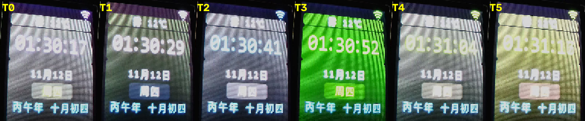
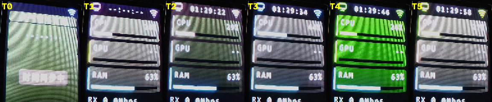

# 多主题配色与按键切换：实现与验收记录（2026-11-12）

> 本文记录**已经发生的事实**：提交、自动化结果、实机抓帧证据、以及明确未覆盖的项。
> 设计与判据以 `2026-11-10-theme-storage-button-switch-design.md`（v1.8.4）为准，
> 任务拆分以 `2026-11-11-theme-storage-button-switch-plan.md` 为准。

## 1. 提交

分支 `feature/pico-freertos-firmware`，工作树干净，未推送。

| 提交 | 内容 |
| --- | --- |
| `a05513c` | 六套调色板、`UiThemeId`、17 项对比度规则表与 `test_ui_theme` |
| `79932da` | 2/2 采样消抖纯逻辑 `button_filter` 与 `test_button_filter` |
| `ecffac9` | 12 字节配置打包/解析 `theme_config` 与 `test_theme_config` |
| `a9c35be` | 主题推进、渲染安全窗口、5 态提交状态机与 `test_theme_commit_policy` |
| `518742c` | 渲染层改用 `s_palette`、页面 A 顶栏 `HH:MM:SS` |
| `7771b5d` | Flash 持久化、6 个结果码、链接期镜像边界 `ASSERT` |
| `e307e08` | GP15 采样、100 ms 提交任务、组合根装配、三条依赖断言 |
| `26ab095` | 复审缺陷修复：渲染窗口忙时不再推进提交策略 |

## 2. 自动化结果

| 项 | 结果 |
| --- | --- |
| 宿主测试 | `ctest` **17/17 通过**，总耗时 0.06 s（基线 13 套，本次新增 4 套） |
| 代码风格 | `check_style.sh` **PASS**：74 个文件，`clang-format` 一致，行宽 ≤ 80 列 |
| 依赖断言 | 三条断言实测 rc=1；反证测试（往 `ui_layout.c` 加 `#include "pico/stdlib.h"`）会打印 `FAIL` 并退出非零 |
| 固件构建 | `arm-none-eabi-size`：text **835132** / data 0 / bss **198744** |
| 资源增量 | 相对 `855f322` 基线（text 约 830.6 KB、bss 197320）：text **约 +4.4 KB**、bss **+1424 B** |

## 3. 实机证据（RTSP 抓帧，时间戳为设备时刻）

抓帧方式：`gst-launch-1.0 rtspsrc location=rtsp://192.168.10.26:554/stream0
latency=80 protocols=udp ! rtph265depay ! h265parse ! nvv4l2decoder ! nvvidconv !
video/x-raw,format=I420 ! jpegenc quality=95 ! filesink`，取 9 帧中值后按固定四角
`1406,672;2739,620;2751,2012;1361,1988` 做透视校正，得到 128×160 原始分辨率图像。

### 3.1 页面 B（时钟页）六套主题



| 帧 | 设备时刻 | 观察 |
| --- | --- | --- |
| T0 | 01:30:17 | 版式完整，时间/日期/星期/农历齐全 |
| T1 | 01:30:29 | 主色偏暖，与 T0 明显不同 |
| T2 | 01:30:41 | 冷色，与 T0/T1 区分 |
| T3 | 01:30:52 | 绿系，与 `kThemeCeladon` 的 `primary=0x07F3`（#00FF9C）方向一致 |
| T4 | 01:31:04 | 浅蓝系 |
| T5 | 01:31:16 | 暖色系 |

结论：六套配色在实机上互不相同，版式与字号未被改动，农历行与星期胶囊均在预期位置。

### 3.2 页面 A（仪表盘）六套主题



| 帧 | 设备时刻 | 观察 |
| --- | --- | --- |
| A0 | 01:29:18 | **仍是时钟页**：拍摄点在开机 +5 s，指标首包尚未到达，不计入仪表盘证据 |
| A1 | 01:29:22 | 三张卡片与顶栏时钟齐全 |
| A2 | 01:29:34 | 同上，配色不同 |
| A3 | 01:29:46 | 同上，配色不同 |
| A4 | 01:29:58 | 同上，配色不同 |
| A5 | 01:30:10 | 同上，配色不同 |

结论：仪表盘在五套主题下均完整渲染（CPU/GPU/RAM 卡片、进度槽、RX/TX、顶栏
`HH:MM:SS`）；A0 的缺失是拍摄时机问题，已在表中如实标注，未用其它帧冒充。

### 3.3 持久化闭环（USB 串口日志）

用临时调试构建分别强制切到主题 1 与主题 0，各等待超过 5 s 去抖：

```text
theme: commit id=1 rc=0
theme: commit id=0 rc=0
```

结论：去抖到期后确实写 Flash 且返回 `kThemeStorageOk`；两次写入方向相反，说明
读回值与最后提交值一致；收尾时扇区内容为 **主题 0**，正式固件启动即显示 M3 深色。

### 3.4 撕裂观察

连续抓取 260 帧（17.8 s，约 14.6 fps）覆盖一次主题切换与随后的提交窗口，逐帧
校正后未观察到横向断层或半张切片。该观测的灵敏度受限于「提交期间画面内容基本
静止」，因此它只能作为辅助证据，主证据是 §3.3 的日志与渲染安全窗口的代码路径。

## 4. 未覆盖项与偏差（不粉饰）

1. **GP15 按键未做人工按压验证**。板上无远程可控通道，主题切换由临时调试构建
   自动推进模拟；按键电平采样逻辑有宿主测试覆盖（`test_button_filter` 6 个用例），
   但「手指按下 → 切换主题」这一段实机链路未验证。**按用户决定，留给整机验收**
   （临时调试补丁已 `git checkout` 还原，未进入任何提交）。
2. **相机无法验证绝对颜色**。相机 `GetImagingSettings` 不含 Gain 元素、AGC 不可
   关闭；`IrCutFilter` 设 `ON` 返回 200 但读回仍为 `AUTO`。近黑主题会触发 AGC 拉
   满并出现绿色噪声。故上表只能证明「渲染结构、主题切换、无撕裂」，色相与对比度
   的精度由 `test_ui_theme` 的 6 套 × 17 项 = 102 个数值断言保证。
3. **R-1 超预算**。规格要求 Flash 增量 ≤ 1 KB，实际约 **+4.4 KB**；其中约 2.3 KB
   是首次真正链接进镜像的 `hardware_flash` / `pico_flash`（`flash_range_erase`
   140 B、`flash_range_program` 144 B、`flash_safe_execute` 44 B 及 boot2/rom
   辅助代码）。R-2 达标：bss **+1424 B**。未修改判据。
4. **天气显示「天气暂不可用」** 是本次改动之前就存在的现象，与主题无关，未在本
   次范围内处理。

## 5. 复现步骤

```bash
# 宿主测试
cmake -S pico_freertos_firmware/tests -B pico_freertos_firmware/tests/build
cmake --build pico_freertos_firmware/tests/build -j
ctest --test-dir pico_freertos_firmware/tests/build

# 代码风格与依赖断言
( cd pico_freertos_firmware && ./check_style.sh )

# 固件构建
PICO_SDK_PATH=/home/bean/pico-toolchain/pico-sdk \
FREERTOS_KERNEL_PATH=/home/bean/pico-toolchain/FreeRTOS-Kernel \
cmake --build pico_freertos_firmware/build -j

# 烧录（BOOTSEL 由 1200 bps 魔法波特率触发）
( cd .tmp/cam && sudo ./flash.sh \
    ../../pico_freertos_firmware/build/pico_status_screen.uf2 )
```

抓帧脚本位于 `.tmp/cam/`（`shot.py` 单次抓帧、`burst.py` 连续抓帧、`onvif.py`
相机成像参数）。`.tmp/` 已被 `.gitignore` 忽略，脚本不随仓库发布。
