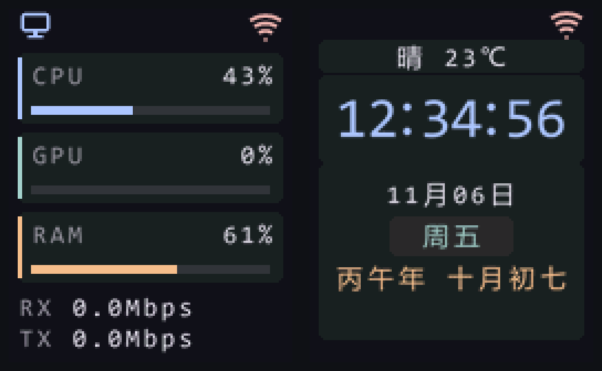

# Pico W 固件（FreeRTOS / C）

本目录是整机固件的 **C + FreeRTOS** 实现，用来替代 `pico/` 下的 MicroPython 版本。
两者共用同一份资源（字模、农历表、根证书）和同一套 UDP 协议，界面在 128×160 分辨率上逐像素对齐。

## 当前界面



左图是仪表盘：顶栏显示 PC 与 Wi-Fi 状态，三张卡片分别显示 CPU、GPU、RAM 占用，
底部是 ETH RX/TX 速率。右图是时钟页：天气胶囊、大号时间、日期、星期胶囊与干支农历。

两张图由 `tests/pipeline_e2e` 在宿主渲染，不是实机照片：连续 5 条真实 UDP 报文经
「解析 → 状态机 → 渲染」得到仪表盘；再把时间推进到指标超时 3 秒之后，得到时钟页。
原始帧缓冲为 128×160、RGB565，这里按 4 倍最近邻放大后拼接。实机运行同一份渲染代码，
接线与 SPI 正常时，屏幕内容应与上图一致。

仪表盘读数为 CPU 43%、GPU 0%、RAM 61%；时钟页时间为 2026-11-06 12:34:56，
农历丙午年十月初七，天气晴 23°C。

## 状态一览

| 项目 | 现状 |
| --- | --- |
| 固件链路 | 显示、Wi-Fi、UDP 8765、NTP、天气、监督任务已接通 |
| 宿主测试 | 13/13 通过（`ctest`，约 0.06 s） |
| 实机 | 2026-11-08 有双模式运行记录；验收结论待确认 |
| 资源 | Flash 804 KB / RAM 189 KB / SRAM 余 75 KB |

## 界面与状态机

- 收到 UDP 指标：显示仪表盘，CPU/GPU/RAM 卡片与 ETH RX/TX 刷新。
- 连续 3 秒没有新指标：切到时钟页，PC 图标隐藏。
- 时钟页收到新指标：立即切回仪表盘。
- 仪表盘每 20 ms 取一次快照，只重绘脏区；RAM 超过 90% 时进度条转红。
- 时钟页在 NTP 未同步时显示「时间同步中」，天气未就绪时显示占位。

## 为什么是 FreeRTOS 而不是 RT-Thread

Pico W 的无线模块是 CYW43439。pico-sdk 提供了开箱即用的
`pico_cyw43_arch_lwip_sys_freertos`，CYW43439 驱动、lwIP 与 FreeRTOS 的
同步原语已经接好；RT-Thread 的 RP2040 支持缺少这套无线驱动，移植它等于先写一遍
厂商驱动再谈业务，风险与工期都不可接受。因此选 pico-sdk + FreeRTOS **SMP 双核**：

| 核 | 职责 |
| --- | --- |
| Core 0 | Wi-Fi 连接、UDP 指标接收、NTP 对时、高德 HTTPS 天气、监督任务 |
| Core 1 | SPI+DMA 刷屏，独立渲染循环，不参与任何网络等待 |

两个核之间**不加共享锁**：状态由 `system_state` 保存一份快照，渲染任务每帧先把快照
快速拷贝成私有副本再画，绘制全程不持锁，界面因此不会被网络抖动卡住。

## 硬件接线

| 屏幕信号 | Pico W 引脚 |
| --- | --- |
| SCL / SCK | GP18 |
| SDA / MOSI | GP19 |
| CS | GP17 |
| DC | GP21 |
| RST | GP20 |

这套引脚与仓库里的 `pico/st7735.py` 一致；该驱动已在实机预览中运行过。
初始化命令序列（B1/B2/B3/B4/C0–C5/E0/E1、INVOFF、MADCTL 0xC8、COLMOD 0x05、DISPON）
逐个字节对齐。针对杜邦线手工跳线的物理特性，固件 SPI 时钟选为 10 MHz（大幅降低
高频反射与振铃），传输改用同步阻塞式切片轮询，并在每个命令周期与切片数据传输前后
强制独立翻转片选 CS 电平，显式复位 ST7735S 内部字节解包状态机，消除异步
DMA 导致的数据相位偏移和彩色横纹花屏。

屏幕 128×160、RGB565、竖屏，显示偏移为 0（`colstart=rowstart=0`）。

## 环境要求

| 项目 | 要求 |
| --- | --- |
| 交叉编译器 | `arm-none-eabi-gcc` 13.2 及以上（Ubuntu：`gcc-arm-none-eabi`） |
| pico-sdk | 2.3.1 及以上 |
| FreeRTOS-Kernel | 含 `portable/ThirdParty/GCC/RP2040` 的版本 |
| Python | 3.8+，仅构建脚本使用，无第三方依赖 |
| picotool | 可选；缺失时自动回退到本仓库的 `tools/elf2uf2.py` |

工具链路径通过环境变量传入，默认值见 `build.sh`：

```bash
export PICO_SDK_PATH=$HOME/pico-toolchain/pico-sdk
export FREERTOS_KERNEL_PATH=$HOME/pico-toolchain/FreeRTOS-Kernel
```

> **务必初始化 SDK 子模块**。`pico-sdk` 的 `lib/cyw43-driver` 若是空目录，
> CMake 会报「找不到 cyw43 相关 target」，且错误信息不会点明是子模块没拉。
>
> ```bash
> cd "$PICO_SDK_PATH" && git submodule update --init lib/cyw43-driver lib/lwip lib/mbedtls
> ```

## 配置密钥

仓库不保存明文凭据；构建前由仓库根的 `tools/sync_secrets.py` 从 Python 配置生成一个
被 `.gitignore` 忽略的 `include/firmware_secrets.h`。

```python
# pico/wifi_secrets.py
SSID = "你的 2.4 GHz 热点"
PASSWORD = "口令"

# pico/weather_secrets.py
AMAP_WEB_KEY = "高德 Web 服务 Key"
CITY_OVERRIDE_ADCODE = "330200"   # 可选；留空则用固件内置默认城市
```

`build.sh` 会自动执行同步脚本，也可以在 `pico_freertos_firmware/` 下单独运行：

```bash
python3 ../tools/sync_secrets.py
```

未配置时的降级行为：SSID 为空 → Wi-Fi 模块不初始化、其余任务照常运行并显示
未联网图标；高德 Key 为空 → 跳过天气请求，天气行显示占位。两种情况都不会崩溃。

## 构建与烧录

```bash
cd pico_freertos_firmware
./build.sh
```

产物：

- `build/pico_status_screen.uf2` —— 直接拖进 BOOTSEL 模式下的 `RPI-RP2` 磁盘
- `build/pico_status_screen.elf` / `.bin` / `.map`

按住 BOOTSEL 上电或用 `picotool reboot -f -u` 进入 BOOTSEL，随后把 `.uf2` 拖到
`RPI-RP2` 磁盘即可。**注意**：C 固件会覆盖 MicroPython 解释器；想回到 MicroPython
需要重新刷官方 `.uf2`。

## 串口日志

`stdio` 走 USB CDC，`minicom -D /dev/ttyACM0 -b 115200` 或任意串口工具即可。
启动顺序与关键日志：

```text
复位原因：非看门狗（上电或外部复位）。阶段标记 = 0。
Wi-Fi 已初始化，准备连接 SSID：***
Wi-Fi 已连接：***
UDP 指标监听已启动：0.0.0.0:8765
时间已同步：...（东八区）
监督任务已启动：看门狗 8000 毫秒，检查周期 1000 毫秒。
网络子系统启动：Wi-Fi 已创建，UDP 已创建，NTP 已创建，天气已创建。
[诊断] 堆剩余 41232 字节 / 历史最低 39880 字节
  supervisor     状态=3 优先级=3 栈水位=402 字
  ...
```

### 看门狗与复位

监督任务每秒检查 7 个子系统（Wi-Fi、UDP、NTP、天气、UI、双核心跳）是否在签到，
**全部健康才调用 `watchdog_update()`**。任何一项超过各自的超时阈值未签到，它就停止
喂狗并打印（例如）：

```text
[监督] 子系统「天气服务」超过 30000 毫秒未签到，停止喂狗。
        看门狗将在 8000 毫秒后复位整机。
```

8 秒后硬件看门狗复位整机，重启后第一行会说明这次是看门狗复位，以及复位前监督任务
处在哪个阶段。阶段标记写在看门狗 scratch 寄存器里，普通 RAM 内容复位后会丢失，
这是唯一能跨复位传递信息的渠道。

超时阈值：UI 1000 ms、双核心跳 3000 ms、Wi-Fi 5000 ms、UDP 15000 ms、
NTP/天气 30000 ms。NTP 与天气给得宽，是因为一次 TLS 握手加证书校验本身就可能
耗时数秒。

### 诊断行

每 10 秒打印一次堆剩余、历史最低堆、以及整机任务表（状态、优先级、栈最低水位）。
设备上没有调试器可用，这行日志是判断「某个任务栈给少了」的唯一依据：某个任务的
`栈水位` 长期接近 0 就说明它快溢出了。

## 测试

固件代码中所有不依赖硬件外设的部分（协议解析、状态机、农历换算、布局、渲染、
退避序列、NTP 时间换算、天气 JSON 解析、监督超时判定）都能在主机上编译运行，
共 13 个测试套件：

```bash
cd pico_freertos_firmware/tests
cmake -S . -B build
cmake --build build -j
ctest --test-dir build --output-on-failure
```

> 测试要在 `pico_freertos_firmware/tests/` 下的构建目录里运行：字模与农历表是按
> `../../../pico/` 的相对路径读取的，放到 `/tmp` 会直接失败。

本机实测 13/13 通过，耗时约 0.06 s。

其中 `pipeline_e2e` 是端到端串联测试：把 PC 端 `pc_metrics.protocol.encode_packet`
产出的真实字节喂进「解析 → 状态机 → 渲染」，最后落成 PPM 图并用像素断言验收，
同时验证「指标超时 3 秒自动切到时钟页」这条业务规则。本文的两张界面图就来自这个
测试：先渲染仪表盘，再推进时间触发超时，得到时钟页；测试输出两张 PPM，
`tools/ppm_to_png.py` 再把它们转成 PNG。

代码风格由 clang-format（Google 风格，80 列）与行宽检查把关：

```bash
./check_style.sh
```

主机侧还能跑一次真实 UDP 收发联调（本机回环，不需要 Pico），在仓库根目录运行：

```bash
python3 tools/verify_udp_end_to_end.py
```

## 任务与调度

| 任务 | 绑核 | 优先级 | 栈 | 节奏 |
| --- | --- | --- | --- | --- |
| `udp_listener` | 0 | 4 | 4 KB | 阻塞等队列，收到即解析 |
| `supervisor` | 0 | 3 | 2 KB | 1000 ms 检查签到并喂狗 |
| `vTaskUIRender` | **1** | 3 | 2 KB | 20 ms 取快照并画脏区 |
| `wifi_manager` | 0 | 2 | 4 KB | 事件驱动，掉线按 1/3/10/30 s 退避 |
| `ntp_service` | 0 | 2 | 4 KB | 每秒推进软时钟，6 小时同步一次 |
| `heartbeat_core0` | 0 | 2 | 2 KB | 1000 ms 签到，30 秒打一行日志 |
| `heartbeat_core1` | **1** | 2 | 2 KB | 同上 |
| `weather_service` | 0 | 1 | 16 KB | 30 分钟刷新；TLS 握手吃栈 |
| `tcpip_thread` | 0 | lwIP 内部 | 8 KB | lwIP 协议栈 |
| 定时器守护 | 任选 | 2 | 1 KB | FreeRTOS 软件定时器 |

与设计规格的偏差：显示任务栈由规格的 10 KB 降到 2 KB（渲染全程只用两块静态
切片缓冲，栈上不放大数组）；Wi-Fi/UDP/NTP 由规格的各 4 KB 保持不变；天气任务
16 KB 与规格一致。堆从规格的 80 KB 提到 96 KB，理由是 TLS 握手还要动态申请
4~8 KB；当前 SRAM 仍余 75 KB（见下表）。

## 资源占用（实测）

| 项目 | 数值 |
| --- | --- |
| Flash（`text`） | 823 144 字节 ≈ 804 KB |
| RAM（`bss`，含 96 KB FreeRTOS 堆） | 193 220 字节 ≈ 189 KB |
| SRAM 剩余 | 77 116 字节 ≈ 75 KB |
| `.uf2` | 1 638 400 字节（3200 块） |

字模、农历表与两张根证书以 `const` 数据的形式嵌在 Flash 里（`asset_store`），
不占 RAM。任务栈合计约 46 KB，其中天气任务 16 KB（TLS 握手吃栈），
Wi-Fi/UDP/NTP 各 4 KB，显示 2 KB，监督 2 KB，tcpip 线程 8 KB。

## 目录结构

```text
pico_freertos_firmware/
├── build.sh                 交叉编译入口（同步密钥 → CMake → uf2）
├── check_style.sh           clang-format + 80 列行宽闸门
├── CMakeLists.txt           pico-sdk + FreeRTOS SMP 工程，资源以 objcopy 嵌入
├── images/                  README 界面图（宿主渲染，4× 放大）
├── include/                 对外契约头文件
│   ├── system_state.h       快照类型与状态机 API
│   ├── FreeRTOSConfig.h     SMP 双核、96 KB 堆、栈溢出检查
│   ├── lwipopts.h           NO_SYS=0、PBUF 池、tcpip 线程栈
│   ├── mbedtls_project_config.h  裁剪到只留 TLS 1.2 client + ECDHE
│   └── asset_store.h        只读资源访问器
├── src/
│   ├── main.c               启动顺序、FreeRTOS 钩子、双核心跳
│   ├── app/                 supervisor（看门狗）/ supervisor_monitor（纯逻辑）
│   ├── display/             st7735s_driver / font_engine / ui_layout / ui_render
│   ├── network/             wifi_manager / udp_listener / metrics_parser
│   ├── services/            ntp_service / weather_service / lunar_service
│   ├── state/               system_state
│   ├── assets/              asset_store
│   └── platform/            mbedtls_time_source（NTP → mbedTLS 时间注入）
└── tests/                   13 个主机测试 + cJSON 第三方源码
```

密钥同步、字模与农历表生成、主机联调脚本在仓库根的 `tools/` 下；`build.sh` 通过
`../tools/sync_secrets.py` 调用它们。

## 已知限制

1. **实机状态**。仓库的 2026-11-08 提交记录称：已在真实 Pico W + ST7735S 上完成
   烧录，时钟与仪表盘双模式连续运行，并通过 RTSP 画面回传核验。该记录是仓库内的
   实机运行说明，不等同于项目验收结论；本文的宿主测试与渲染图不能替代实机验收。
2. **RP2040 没有 RTC**。断网时无法得到真实时间，时钟页会停在
   `--:--:--` 与「时间同步中」；这不是缺陷，是硬件限制。
3. **城市默认值**。未配置 `CITY_OVERRIDE_ADCODE` 时使用内置默认城市，
   若与实际位置不符，天气内容会显示别的城市。
4. **证书校验依赖时间**。`mbedtls_time_source_is_valid()` 为假时固件不会发起
   HTTPS 请求——1970 年的时间会让所有证书判为「尚未生效」。因此天气必须等
   NTP 成功之后才会开始刷新。
